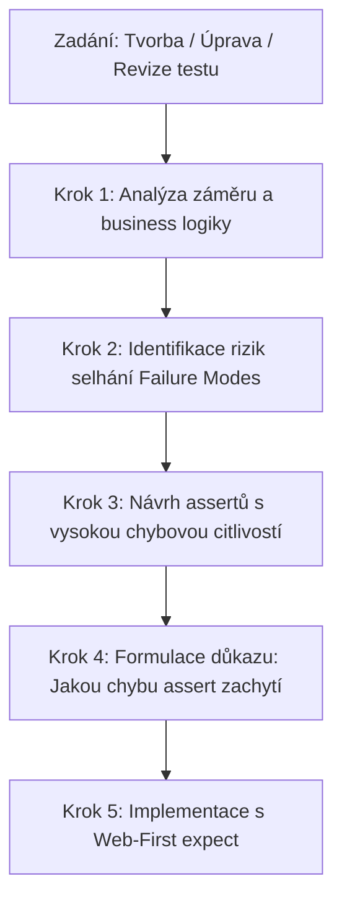

# Assertion Quality Review Skill

Tento skill slouží jako specializovaný standard a auditní nástroj pro tvorbu, úpravu a řízení kvality assertů v automatizovaných testech (především Playwright a pytest).

> **Klíčový princip skillu:**
> Nestačí mechanicky přidat více assertů ani dosáhnout zeleného testu. Cílem je **řídit kvalitu assertů** tak, aby testy získaly **vysokou schopnost odhalovat reálné defekty aplikace (Fault Detection Power)** a eliminovala se falešná pozitivita (zelené testy při rozbité aplikaci).

---

## 1. Důkaz řízení kvality: Zvýšení schopnosti odhalovat chyby (Fault Detection Proof)

Aby byl assert kvalitní, musí existovat přímá vazba mezi assertem a chybou, kterou dokáže zachytit. Při každém návrhu nebo revizi assertu musí být zodpovězena otázka:
> **„K jakému reálnému selhání aplikace může dojít, při kterém by původní test prošel (falešná zelená), ale díky tomuto assertu test spolehlivě selže?“**

### Matice odhalitelných chyb (Defect Detection Matrix)

Následující tabulka prokazuje, jak konkrétní úpravy assertů řízené tímto skillem mění slepé testy na testy odhalující závažné regrese:

| Reálná chyba v aplikaci (Bug / Regrese) | Chování aplikace | Původní povrchní assert | Chování původního testu | Zdokonalený assert (řízený tímto skillem) | Chování nového testu |
| :--- | :--- | :--- | :--- | :--- | :--- |
| **Rozpadlá session po přihlášení** | Backend vrátí redirect na `/courses`, ale selže uložení auth cookie/tokenu. Uživatel je ve skutečnosti anonymní. | `page.wait_for_url("**/courses")` | 🟢 **FALEŠNĚ ZELENÝ** (Chyba pronikne do produkce!) | `expect(header.logout_button).to_be_visible()`<br>`expect(header.user_name).to_contain_text(user["name"])` | 🔴 **ČERVENÝ** (Chyba okamžitě odhalena v CI) |
| **Tiché selhání uložení profilu** | Frontend po kliknutí na Uložit přesměruje na `/home`, ale API vrátilo 500 nebo tichou chybu a nová data v DB nejsou. | `expect(page).to_have_url("**/home")` | 🟢 **FALEŠNĚ ZELENÝ** (Uživatel přichází o data!) | `profile_page.navigate()`<br>`expect(profile_page.phone_input).to_have_value(new_phone)` | 🔴 **ČERVENÝ** (Odhalena chybějící perzistence dat) |
| **Bypass backendové validace IČO** | Uživatel zadá neplatné IČO, frontend sice ukáže rámeček, ale formulář se přesto na pozadí odešle a poškodí data. | `expect(ico_error).to_be_visible()` | 🟢 **FALEŠNĚ ZELENÝ** (Chyba ignorována, data poškozena) | `expect(page).to_have_url(re.compile(r"/profile$"))`<br>`expect(ico_error).to_have_text("Neplatné IČO")` | 🔴 **ČERVENÝ** (Odhaleno neoprávněné odeslání dat) |
| **Falešné odhlášení (Session leak)** | Tlačítko odhlásit se přesměruje na login, ale session token zůstane platný (zranitelnost). | `expect(page).to_have_url("**/login")` | 🟢 **FALEŠNĚ ZELENÝ** (Kritická bezpečnostní díra!) | `profile_page.navigate()`<br>`expect(page).to_have_url("**/login")`<br>`expect(profile_page.heading).not_to_be_visible()` | 🔴 **ČERVENÝ** (Bezpečnostní defekt okamžitě zachycen) |

---

## 2. Tři hlavní režimy aktivace (Kdy skill použít)

### Režim 1: Tvorba nového testu a návrh nových assertů
Kdykoliv píšeš nebo generuješ nový test:
- **Nenavrhuj pouze minimální asserty** (např. pouhé čekání na URL nebo HTTP kód).
- **Aplikuj pravidlo kompletního výsledného stavu:** Ověř změnu URL, viditelnost klíčových prvků (tlačítka, profil), systémové zprávy i zánik prvků předchozího stavu.
- **Používej výhradně web-first auto-retrying asserty** (`expect(locator).to_be_visible()`), nikoliv statické `assert locator.is_visible()`.

### Režim 2: Úprava existujících testů (změna chování aplikace / refaktoring)
Kdykoliv upravuješ existující test kvůli změně funkčnosti, UI nebo opravě pádu testu:
- **ZÁKAZ oslabování assertů:** Nikdy neodstraňuj kontrolu a nenahrazuj konkrétní assert vágním jen proto, aby byl test zelený.
- **Přizpůsob assert novému očekávanému chování** a prověř, zda se nezměnily vedlejší efekty.
- **Doplň negativní ověření** pro stavy, které už po změně nesmí nastat.

### Režim 3: Analýza, audit a revize assertů na vyžádání
Kdykoliv uživatel požádá o kontrolu, analýzu, revizi nebo zhodnocení testu:
- Identifikuj slabiny, slepá místa (false positives) a rizika flakiness.
- Explicitně uveď, **které chyby aplikace stávající asserty minou**.
- Předlož konkrétní refaktoring kódu s ukázkou Před vs Po.

---

## 3. Pilíře řízení kvality assertů

### 1. Pilíř: Kontrola reálného výsledného stavu (Post-conditions & Side-effects)
* **Přihlášení uživatele (Login / Authentication):**
  - [ ] Je zobrazeno tlačítko **Odhlásit se** (Logout)?
  - [ ] Je zobrazeno **jméno, profilová ikona nebo e-mail** přihlášeného uživatele v hlavičce?
  - [ ] Zmizela tlačítka pro nepřihlášené návštěvníky (*Přihlásit se*, *Registrace*)?
  - [ ] Jsou zpřístupněny chráněné sekce aplikace a zobrazen jejich obsah?
* **Odeslání formuláře / Uložení profilu (Create / Update):**
  - [ ] Je zobrazena úspěšná notifikace (Toast message / Flash banner / dialog)?
  - [ ] **Perzistence dat:** Zůstala nová data uložena i po znovunačtení stránky nebo návratu na profil?
  - [ ] Nedošlo k nechtěnému vymazání či přepsání ostatních polí?
* **Smazání záznamu (Delete / Remove):**
  - [ ] Prvek skutečně zmizel z DOMu / není viditelný (`not_to_be_visible()`)?
  - [ ] Snížil se počet položek v seznamu (počet řádků / count klesl o 1)?
  - [ ] Zobrazila se hláška o úspěšném smazání nebo prázdný stav (*Empty state*)?
  - [ ] Přímý pokus o přístup na smazaný záznam vrátí 404 nebo přesměrování?
* **Filtrování a vyhledávání (Search / Filter):**
  - [ ] Zobrazují se pouze položky odpovídající filtru?
  - [ ] Zmizely položky, které filtru neodpovídají?
  - [ ] Zobrazuje se správný počet nalezených výsledků?

---

### 2. Pilíř: Stabilita a Auto-retrying (Playwright Web-first Assertions)
* ❌ **Špatně (Brittle / Flaky – nečeká na asynchronní DOM):**
  ```python
  assert page.locator("#logout-btn").is_visible()
  assert page.url == "https://app.local/courses"
  assert page.locator(".toast").inner_text() == "Uloženo"
  ```
* ✔️ **Správně (Auto-retrying Web-First Assertions):**
  ```python
  expect(page.locator("#logout-btn")).to_be_visible()
  expect(page).to_have_url(re.compile(r"/courses$"))
  expect(page.locator(".toast")).to_have_text("Uloženo")
  ```

---

### 3. Pilíř: Negativní ověření a chybové stavy
* [ ] Zobrazila se správná a specifická chybová hláška (konkrétní text)?
* [ ] Zůstal uživatel na původní stránce (formulář se neodeslal)?
* [ ] Zůstala původní data neporušená?
* [ ] Chráněná stránka pro nepřihlášeného: Ověřeno, že citlivé prvky **nejsou** viditelné a uživatel je přesměrován na login.

---

## 4. Pracovní postup revize a tvorby testu

Kdykoliv tvoříš, upravuješ nebo reviduješ test, postupuj v těchto krocích:



### Krok 1: Analýza záměru
- Zjisti přesně, jaké chování má test ověřovat (User Story / Acceptance Criteria).
- Definuj výchozí stav (Pre-conditions) a spouštěcí akci (Action).

### Krok 2: Identifikace rizik selhání (Failure Modes)
- Co se může v aplikaci rozbít při této akci? (např. session, zápis do DB, validační logika, race condition).

### Krok 3: Návrh assertů s vysokou citlivostí
- Pro každé identifikované riziko navrhni assert, který při výskytu této chyby zčervená.
- Použij Web-First `expect(...)` pro eliminaci flakiness.

### Krok 4: Důkaz přínosu pro uživatele
- V odpovědi uživateli vždy výslovně uveď:
  1. **Nalezené slabiny:** Které chyby aplikace by stávající test přehlédl.
  2. **Zvýšení schopnosti odhalovat chyby:** Jak konkrétně nový assert aplikaci hlídá.
  3. **Kód Před vs Po.**

---

## 5. Katalog vzorových scénářů (Před vs Po)

### Scénář A: Přihlášení uživatele (Login)

#### ❌ Slabý test (pouze technické čekání na URL):
```python
def test_login_success(page: Page, user: dict):
    login_page.login(user["email"], user["password"])
    page.wait_for_url("**/courses")
    # SLABINA: Test projde, i když backend nevytvořil session nebo selhal profil v hlavičce!
```

#### ✔️ Vzorový test (úplné ověření stavu relace v UI):
```python
def test_login_success(page: Page, user: dict, header_page: HeaderPage):
    login_page.login(user["email"], user["password"])
    
    # 1. Ověření URL
    expect(page).to_have_url(re.compile(r"/courses$"))
    
    # 2. Ověření indikátorů přihlášení v hlavičce (odhalí nefunkční session)
    expect(header_page.logout_button).to_be_visible()
    expect(header_page.user_name_or_avatar).to_contain_text(user["name"])
    
    # 3. Negativní kontrola: Anonymní prvky zmizely
    expect(header_page.login_button).not_to_be_visible()
    step("Ověřeno úspěšné přihlášení: zobrazeno tlačítko Odhlásit se a jméno uživatele")
```

---

### Scénář B: Aktualizace profilu (Form Submit & Persistence)

#### ❌ Slabý test (pouze přesměrování bez ověření uložení dat):
```python
def test_profile_update(profile_page: ProfilePage, page: Page):
    profile_page.update_profile(phone="+420777123456", ico="27082440")
    expect(page).to_have_url(f"{profile_page.base_url}/home")
    # SLABINA: Test projde i při tichém selhání zápisu do DB!
```

#### ✔️ Vzorový test (ověření přesměrování, notifikace a perzistence):
```python
def test_profile_update(profile_page: ProfilePage, page: Page):
    new_phone = "+420777123456"
    new_ico = "27082440"
    
    profile_page.update_profile(phone=new_phone, ico=new_ico)
    
    # 1. Potvrzení o uložení a přesměrování
    expect(page).to_have_url(re.compile(r"/home$"))
    expect(profile_page.success_toast).to_be_visible()
    
    # 2. Ověření reálné perzistence v DB/UI (odhalí tiché selhání uložení)
    profile_page.navigate()
    expect(profile_page.phone_input).to_have_value(new_phone)
    expect(profile_page.ico_input).to_have_value(new_ico)
    step("Ověřeno, že aktualizované údaje profilu (telefon a IČO) přetrvaly v systému")
```

---

## Odkazy na doplňující materiály
- Kontrolní checklist a matice: [references/checklist.md](./references/checklist.md)
