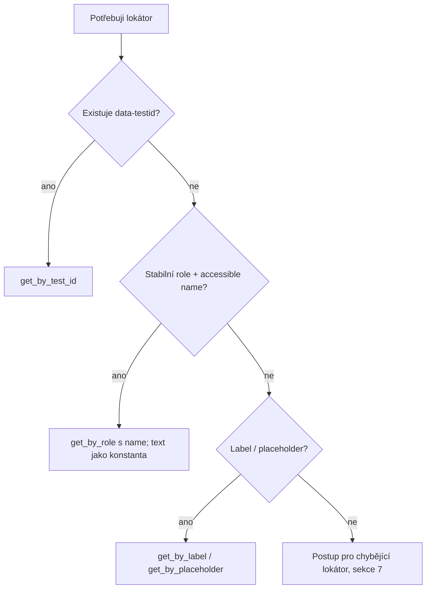

# Locator Strategy Skill

Standard pro tvorbu, opravu a audit lokátorů v Page Objectech (Playwright + pytest, Python).

> **Klíčový princip:**
> Lokátor má cílit na **kontrakt prvku** (`data-testid`, role, label), ne na **strukturu DOM** (pořadí, CSS třídy, hloubka zanoření). Priorita: `data-testid` → role + name → label → placeholder → text.

---

## 1. Režimy aktivace

### Režim 0: Psaní, generování nebo úprava testů (např. "Napiš test pro přihlášení")
- **Pravidlo č. 1:** V testech (`tests/`) se nesmí objevit žádné lokátory (`page.locator()`, `page.get_by_*()`, CSS, XPath).
- Všechny prvky a interakce musí vést přes metody a atributy příslušného Page Objectu v `pages/`.
- Pokud v Page Objectu prvek chybí, vytvoř jej podle pravidel tohoto skillu (kontrakt prvku, `data-testid`).

### Režim 1: Tvorba nového lokátoru / Page Objectu
- Projdi rozhodovací strom (sekce 2).
- Ověř jednoznačnost: `expect(locator).to_have_count(1)` (nebo ověř ručně přes `locator.count()`).
- Lokátor ulož jako atribut `Locator` v Page Objectu (sekce 3).

### Režim 2: Oprava rozbitého / křehkého lokátoru
- **Nejdřív zjisti příčinu:** zmizel prvek? Je více shod (strict mode)? Změnil se text nebo jazyk? Změnilo se `data-testid`?
- Teprve potom změň lokátor. **Nikdy ho nezvágňuj** (např. přechod na `.first` jen proto, aby test prošel).
- Po opravě ověř jednoznačnost a spusť dotčené testy.

### Režim 3: Audit lokátorů na vyžádání
- Spusť `python .agents/skills/locator-strategy/scripts/audit_locators.py pages tests`.
- Nálezy roztřiď podle závažnosti (ERROR / WARN / TODO) a ke každému navrhni Před vs Po.
- Audit **nic nemění**, opravy provádí až po schválení uživatele.

---

## 2. Rozhodovací strom



| Strategie | Kdy | Poznámka |
| :--- | :--- | :--- |
| `get_by_test_id("x")` | **Vždy první volba** | Nezávisí na jazyce ani vzhledu. |
| `get_by_role("button", name=...)` | `data-testid` chybí | Text jen jako pojmenovaná konstanta. |
| `get_by_label(...)` | Formulářová pole bez testid | Závisí na jazyce, pozor na lokalizaci. |
| `get_by_placeholder(...)` | Poslední možnost pro inputy | Placeholder se často mění. |
| `get_by_text(...)` | Jen statický text, krajní případ | Nejkřehčí z povolených. |

---

## 3. Pravidla Page Object Modelu

1. **Zero-Inline-Locators (TVRDÝ ZÁKAZ):** v `tests/` nesmí být žádný lokátor (`page.locator()`, `page.get_by_*()`, CSS/XPath). Testy používají jen atributy a metody Page Objectů.
2. Lokátory jsou atributy typu `Locator`, inicializované v `__init__` Page Objectu.
3. Lokátory závislé na parametru jsou **metody** (`def course_card(self, name) -> Locator`).
4. Sdílené prvky (navigace) patří do komponenty (`Navbar`), ne do jednotlivých stránek.
5. Jedna logická obrazovka = jeden Page Object.

---

## 4. Dynamický obsah (seznamy, karty, tabulky)

- Konkrétní položku hledej přes `filter`, ne přes pořadí:
  ```python
  def course_card(self, name: str) -> Locator:
      return self.course_cards.filter(has_text=name)
  ```
- Zužuj hledání do kontejneru: `self.course_card(name).get_by_role("button", name=DETAIL_LABEL)`.
- `.first` / `.nth()` jen tehdy, když na pořadí opravdu záleží, **a vždy s komentářem s důvodem**.
- Strict mode violation řeš zpřesněním lokátoru, ne přidáním `.first`.

---

## 5. Lokalizace (CZ / EN)

- Preferuj `data-testid`, který na jazyce nezávisí.
- Text v lokátoru (role name, label, text) definuj jako **pojmenovanou konstantu** na jednom místě v Page Objectu.
- Textové hlášky z backendu (často anglické) nejsou stabilní kontrakt, nepoužívej je jako lokátor, pokud existuje testid.

---

## 6. Zakázané vzory

| Vzor | Proč je zlý | Čím nahradit |
| :--- | :--- | :--- |
| XPath (`xpath=`, `//div/...`) | Rozbije se při jakékoli změně struktury | `get_by_test_id` / role |
| `:nth-child`, `nth=` | Závisí na pořadí | `filter(has_text=...)` |
| CSS třídy (`.btn-primary`) | Mění se se stylováním | `get_by_test_id` / role |
| `.first` / `.nth()` bez komentáře | Skrývá strict mode violation | Zpřesnit lokátor |
| `time.sleep`, `wait_for_timeout` | Flaky, pomalé | Web-first `expect` / auto-wait |
| Text závislý na jazyce přímo v lokátoru | Rozbije se při změně jazyka | Konstanta nebo `data-testid` |
| Jakýkoli lokátor v `tests/` | Porušení POM | Atribut Page Objectu |

---

## 7. Postup, když prvek požadovaný lokátor (`data-testid`) nemá

Aplikace je cizí a nemáme na ni zásah. Postupuj takto:

1. **Ověř, že `data-testid` opravdu chybí.** Prohlédni DOM (codegen / snapshot) a zkontroluj, jestli nemá podobný testid pod jiným názvem.
2. **Projdi žebříček náhrad shora dolů** a vezmi první stabilní, jednoznačnou možnost:
   1. `get_by_role(role, name=...)`
   2. `get_by_label(...)`
   3. `get_by_placeholder(...)`
   4. `get_by_text(...)` jen pro statický text, text v konstantě
   5. Pokud je prvek uvnitř kontejneru s testid, zúž hledání: `kontejner.get_by_role(...)`
3. **I při chybějícím testid je zakázáno:** XPath, `nth-child`, CSS třídy, absolutní cesty v DOM, `.first` jen kvůli strict mode.
4. **Ověř jednoznačnost** (`to_have_count(1)`) a nezávislost na pořadí.
5. **Označ fallback v kódu** greppovatelnou značkou (audit ji vypíše):
   ```python
   # TODO(testid): chybí data-testid pro odeslání formuláře; fallback role+name
   self.submit_button = page.get_by_role("button", name=SUBMIT_LABEL)
   ```
6. **Vytvoř požadavek na vývojáře** a uveď ho v odpovědi:
   ```
   Stránka: /courses/create | Prvek: tlačítko "Vytvořit kurz"
   Navržený testid: create_course_submit_button
   Důvod: lokátor dnes závisí na českém textu
   ```
7. **Když žádná náhrada není stabilní** (prvek bez role, textu a labelu), **zastav práci na tomto lokátoru, nic nevymýšlej** a zeptej se uživatele.
8. **Až vývojáři testid doplní,** vyměň fallback za `get_by_test_id` a smaž značku TODO.

---

## 8. Ladění lokátoru

- `playwright codegen <URL>` – návrh lokátorů z reálné stránky.
- `page.pause()` – Playwright Inspector pro interaktivní zkoušení.
- `locator.highlight()` – vizuální kontrola, co lokátor zasáhl.
- `locator.count()` – kolik prvků lokátor najde (musí být 1 pro jednotlivý prvek).
- Trace Viewer (`--tracing on`) – rozbor padlého testu.

---

## 9. Výstupní formát odpovědi agenta

Vždy uveď:
1. **Co bylo křehké / chybělo** (a které chyby by to způsobilo).
2. **Nový lokátor** (kód Před vs Po).
3. **Jak bylo ověřeno** (jednoznačnost, spuštění testů, audit).
4. U chybějícího testid navíc **požadavek na vývojáře** (sekce 7, krok 6).

---

## 10. Odkazy

- Checklist a tahák API: [references/checklist.md](./references/checklist.md)
- Konvence `data-testid`: [references/testid-conventions.md](./references/testid-conventions.md)
- Příklady Před vs Po: [references/examples.md](./references/examples.md)
- Audit skript: [scripts/audit_locators.py](./scripts/audit_locators.py)
- Související skill pro asserty: `assertion-quality-review` (lokátory řeší tento skill, asserty tamten)

