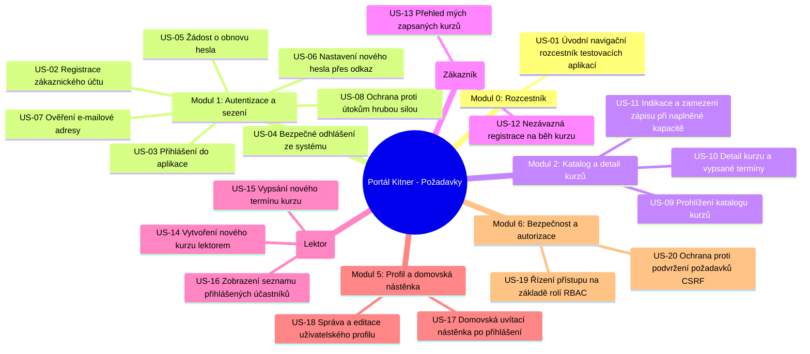

# Specifikace požadavků podle zdrojového kódu (User Stories)

Tento dokument obsahuje ucelenou specifikaci požadavků sestavenou na základě **analýzy zdrojových kódů aplikace** v adresáři `tested_app_src`. Akceptační kritéria jsou formulována ve standardním agilním byznysovém formátu zaměřeném na uživatelské chování, byznys pravidla a podmínky převzetí.

---

## 1. Architektonický kontext aplikace

Aplikace funguje jako webový portál pro vzdělávání a správu kurzů s rozdělením uživatelů do rolí (RBAC):
- **Návštěvník (Guest):** Nepřihlášený uživatel. Má přístup k úvodnímu rozcestníku, katalogu kurzů, detailu kurzu a formulářům pro registraci, přihlášení a obnovu hesla.
- **Zákazník (Customer):** Běžný uživatel se zákaznickým účtem. Může se nezávazně zapisovat na volné běhy kurzů, prohlížet přehled svých zapsaných kurzů a spravovat svůj profil.
- **Lektor (Lector):** Uživatel s lektorským oprávněním. Může vytvářet nové kurzy, vypisovat k nim nové termíny (běhy) a prohlížet seznam zapsaných studentů u jednotlivých běhů.

---

## 2. Přehledová mapa User Stories

---

## 3. Detailní specifikace User Stories

---

### Modul 0: Úvodní navigační rozcestník (Linktree)

#### US-01: Úvodní navigační rozcestník testovacích aplikací
- **Jako:** Návštěvník portálu
- **Chci:** Mít na úvodní stránce portálu k dispozici přehledný rozcestník s odkazy na jednotlivé testovací aplikace a kurzy
- **Abych:** Se mohl snadno zorientovat a přejít do požadované sekce
- **Akceptační kritéria:**
  - Úvodní stránka přehledně zobrazuje seznam dostupných testovacích nástrojů a aplikací portálu.
  - Seznam obsahuje funkční externí odkazy na testovací moduly: Kalkulačka, Testovací login, NextDate a Registrace na kurz (včetně výpisu).
  - Stránka obsahuje výrazný odkaz pro vstup do aplikace kurzů (*„Demo-login“*), který návštěvníka nasměruje přímo do katalogu kurzů.

---

### Modul 1: Autentizace a správa uživatelského sezení (Authentication)

#### US-02: Registrace zákaznického účtu s automatickým přihlášením
- **Jako:** Nový zájemce o vzdělávání
- **Chci:** Zaregistrovat si nový uživatelský účet zadáním svého jména, e-mailu a hesla s potvrzením
- **Abych:** Získal zákaznický přístup a mohl se přihlašovat na vypsané kurzy
- **Akceptační kritéria:**
  - Registrační formulář obsahuje pole pro jméno, e-mail, heslo a potvrzení hesla.
  - Všechna formulářová pole jsou povinná.
  - E-mailová adresa musí být v platném formátu a v systému unikátní (nelze registrovat již existující e-mail).
  - Zadaný e-mail je před validací normalizován (odstranění mezer na začátku a konci) a systém je při ověřování unikátnosti necitlivý na velikost písmen.
  - Heslo musí splňovat definovaná bezpečnostní pravidla a musí se přesně shodovat s potvrzovacím polem.
  - V případě neplatně vyplněných údajů zůstává uživatel na formuláři a pod příslušnými poli se zobrazí srozumitelná chybová hlášení.
  - Po úspěšné registraci je uživateli automaticky přiřazena role zákazníka, je rovnou přihlášen do systému a přesměrován na domovskou stránku.
  - Na stránce registrace je k dispozici přímý odkaz pro přihlášení již existujících uživatelů a odkaz pro obnovu zapomenutého hesla.

#### US-03: Přihlášení do aplikace
- **Jako:** Registrovaný uživatel (zákazník nebo lektor)
- **Chci:** Zadat svůj e-mail a heslo na přihlašovací stránce
- **Abych:** Získal přístup ke všem funkcím a oprávněním příslušejícím mé roli
- **Akceptační kritéria:**
  - Přihlašovací formulář obsahuje pole pro e-mail a heslo.
  - Obě pole jsou povinná – při odeslání prázdného formuláře je uživatel upozorněn na chybějící údaje.
  - Zadaný e-mail je tolerantní k velikosti písmen (case-insensitive) a systém automaticky ořezává mezery před a za adresou.
  - Při zadání neexistujícího e-mailu nebo chybného hesla systém přístup odmítne a zobrazí jednotnou chybovou zprávu o neplatných údajích (ochrana proti odhadování registrovaných e-mailů).
  - Po úspěšném ověření údajů je uživatel přihlášen a přesměrován do systému na domovskou stránku.
  - Horní navigace se okamžitě přizpůsobí přihlášenému stavu: skryje se volba pro přihlášení a zpřístupní se privátní sekce (přehled kurzů, moje kurzy, domovská stránka, profil, odhlášení).
  - Formulář plně podporuje přístupné ovládání z klávesnice: přechod mezi prvky klávesou `Tab` (Email ➔ Heslo ➔ Přihlásit) a odeslání stiskem klávesy `Enter`.

#### US-04: Bezpečné odhlášení ze systému
- **Jako:** Přihlášený uživatel
- **Chci:** Mít v horní navigaci trvale dostupnou možnost se odhlásit
- **Abych:** Bezpečně ukončil své sezení a zabránil neoprávněnému přístupu k mému účtu
- **Akceptační kritéria:**
  - Tlačítko pro odhlášení je pro přihlášeného uživatele trvale viditelné v horní navigační liště.
  - Kliknutím na odhlášení dojde k okamžitému zneplatnění uživatelského sezení a smazání přístupových cookies/tokenů.
  - Uživatel je přesměrován na výchozí veřejnou stránku a v navigaci se opět zobrazí volba pro přihlášení.
  - Po odhlášení již nelze přistupovat k privátním funkcím ani k profilu uživatele.

#### US-05: Žádost o obnovu zapomenutého hesla
- **Jako:** Uživatel, který zapomněl své heslo
- **Chci:** Zadat svůj e-mail na stránce obnovy hesla a požádat o resetovací odkaz
- **Abych:** Mohl bezpečně nastavit nové heslo ke svému účtu
- **Akceptační kritéria:**
  - Formulář obsahuje pole pro e-mail a odesílací tlačítko.
  - Pole je povinné a ověřuje se platný formát e-mailové adresy.
  - Pokud e-mail není zadán nebo má chybný formát, formulář zobrazí validační chybu.
  - Po odeslání platné žádosti systém vygeneruje bezpečný, časově omezený resetovací odkaz a v rozhraní zobrazí potvrzení o odeslání požadavku.

#### US-06: Dokončení změny hesla pomocí tokenu
- **Jako:** Uživatel s platným resetovacím odkazem
- **Chci:** Zadat nové heslo a jeho potvrzení
- **Abych:** Nahradil zapomenuté heslo novým a mohl se přihlásit
- **Akceptační kritéria:**
  - Stránka ověří platnost resetovacího tokenu předaného v odkazu.
  - Formulář vyžaduje zadání nového hesla a jeho kontrolní potvrzení.
  - Heslo musí splňovat bezpečnostní pravidla a obě zadaná pole se musí shodovat.
  - Po úspěšném uložení nového hesla systém zobrazí potvrzovací zprávu a nabídne přímý odkaz pro přihlášení novými údaji.
  - V případě neplatného nebo vypršeného odkazu je uživatel informován o neplatnosti požadavku.

#### US-07: Ověření e-mailové adresy (Email Verification)
- **Jako:** Registrovaný uživatel nebo provozovatel portálu
- **Chci:** Aby bylo vlastnictví zadané e-mailové adresy ověřováno potvrzovacím odkazem s možností vyžádat si odkaz znovu
- **Abych:** Měl jistotu, že uživatelský účet je svázán se skutečnou a ověřenou e-mailovou schránkou
- **Akceptační kritéria:**
  - Po registraci systém vygeneruje a odešle na uživatelův e-mail časově omezený, bezpečně podepsaný ověřovací odkaz.
  - Otevření platného odkazu označí e-mail uživatele za ověřený a uživatel je informován o úspěšném dokončení ověření.
  - Pokus o ověření s pozměněným nebo vypršeným odkazem je systémem zamítnut.
  - Uživatel má možnost z aplikace požádat o opětovné zaslání nového ověřovacího odkazu, pokud původní neobdržel nebo expiroval.
  - Znovuzaslání ověřovacího e-mailu je chráněno časovým limitem proti zahlcení.

#### US-08: Ochrana proti útokům hrubou silou na přihlášení (Rate Limiting)
- **Jako:** Správce systému
- **Chci:** Aby systém omezoval počet opakovaných neúspěšných pokusů o přihlášení
- **Abych:** Zabránil slovníkovým útokům a pokusům o neoprávněné prolomení hesel
- **Akceptační kritéria:**
  - Systém sleduje počet po sobě jdoucích neúspěšných pokusů o přihlášení pro daný e-mail a přístupové místo.
  - Uživatel má povolen limit maximálně 5 neúspěšných pokusů.
  - Při překročení tohoto limitu dojde k dočasné blokaci dalších pokusů a systém uživateli oznámí počet sekund, po které musí vyčkat.
  - Po úspěšném přihlášení se počítadlo neúspěšných pokusů automaticky vynuluje.

---

### Modul 2: Katalog a detail kurzů (Courses Catalog)

#### US-09: Prohlížení katalogu kurzů
- **Jako:** Návštěvník nebo registrovaný student
- **Chci:** Zobrazit přehledný katalog všech nabízených kurzů
- **Abych:** Měl přehled o dostupných vzdělávacích tématech, cenách a kapacitách
- **Akceptační kritéria:**
  - Stránka katalogu přehledně zobrazuje seznam všech aktuálně nabízených kurzů.
  - U každého kurzu je zobrazen název, stručný popis, maximální kapacita účastníků a cena zaokrouhlená na celé koruny.
  - Má-li kurz nahrán grafický náhled, zobrazí se u karty kurzu; v opačném případě se zobrazí neutrální výchozí obrázek.
  - Z každé karty kurzu je možné přejít na podrobný detail vybraného kurzu.
  - Pokud si katalog prohlíží nepřihlášený návštěvník, pod nabídkou kurzů se zobrazí výzva k registraci s přímým odkazem.

#### US-10: Zobrazení detailu kurzu a vypsaných termínů
- **Jako:** Zájemce o konkrétní kurz
- **Chci:** Zobrazit podrobné informace o vybraném kurzu a seznam všech jeho vypsaných termínů
- **Abych:** Zjistil přesná data konání a aktuální obsazenost jednotlivých běhů
- **Akceptační kritéria:**
  - Detail kurzu zobrazuje kompletní název kurzu, podrobný obsahový popis, náhledový obrázek a cenu kurzu.
  - Stránka obsahuje sekci se seznamem všech vypsaných termínů (běhů) daného kurzu.
  - U každého termínu je zobrazeno datum zahájení, datum ukončení a aktuální poměr obsazenosti vůči celkové kapacitě (např. *3/12*).
  - Nepřihlášeným návštěvníkům se na konci stránky zobrazí výzva k vytvoření účtu.

#### US-11: Vizuální indikace a zamezení zápisu při naplněné kapacitě
- **Jako:** Zákazník vybírající si termín kurzu
- **Chci:** Mít možnost se přihlásit pouze na termíny, které mají volná místa
- **Abych:** Se nepokoušel registrovat na již plně obsazené běhy
- **Akceptační kritéria:**
  - Tlačítko pro nezávaznou registraci se přihlášenému zákazníkovi zobrazuje pouze u běhů, které mají volnou kapacitu.
  - Kliknutí na registraci přesměruje zákazníka do objednávkového formuláře daného běhu.
  - Pokud je kapacita běhu zcela naplněna, možnost registrace se nenabízí a termín je indikován jako plně obsazený.

---

### Modul 3: Zápis na kurz a Moje kurzy (Role: Zákazník)

#### US-12: Nezávazná registrace na běh kurzu s validací IČO a telefonu
- **Jako:** Přihlášený zákazník
- **Chci:** Dokončit nezávaznou registraci na zvolený termín kurzu zadáním svého IČO a telefonního čísla
- **Abych:** Si zarezervoval místo a předal organizátorovi kontaktní a fakturační údaje
- **Akceptační kritéria:**
  - Registrační formulář obsahuje pole pro IČO, telefonní číslo a potvrzovací tlačítko.
  - Telefonní číslo je povinné a musí obsahovat alespoň 9 číslic.
  - Pokud uživatel zadá IČO, systém prověří jeho platnost pomocí oficiálního algoritmu kontrolního součtu (8místné číslo s váženým součtem modulo 11).
  - V případě neplatného telefonu nebo IČO je uživatel upozorněn chybovou hláškou u daného pole a formulář se neodešle.
  - Zápis na kurz je povolen výhradně uživatelům v roli zákazníka.
  - Zadané IČO a telefon se automaticky uloží do profilu uživatele a vytvoří se vazba přihlášeného studenta na daný běh kurzu.
  - Po úspěšném zápisu obdrží zákazník potvrzení o registraci a je přesměrován do sekce svých zapsaných kurzů.

#### US-13: Přehled mých zapsaných kurzů
- **Jako:** Přihlášený zákazník
- **Chci:** Mít k dispozici přehled všech kurzů a termínů, na které jsem se zapsal
- **Abych:** Měl stálou kontrolu nad svými termíny a místem konání výuky
- **Akceptační kritéria:**
  - Sekce *„Moje kurzy“* je přístupná z navigace pouze pro přihlášené zákazníky.
  - Přehled zobrazuje všechny kurzy, ke kterým má uživatel aktivní zápis.
  - U každého zapsaného kurzu se zobrazují klíčové organizační informace:
    - Název, popis a cena kurzu
    - Datum první a poslední lekce
    - Den v týdnu a čas konání lekcí
    - Místo konání nebo forma výuky (např. prezenční adresa či online)
  - Z každého kurzu v přehledu je možné přejít na detail daného kurzu.

---

### Modul 4: Správa kurzů a výuky (Role: Lektor)

#### US-14: Vytvoření nového kurzu s kontrolou poměru stran obrázku
- **Jako:** Přihlášený lektor
- **Chci:** Zadat do systému nový kurz včetně parametrů a náhledového obrázku
- **Abych:** Zveřejnil novou vzdělávací nabídku v katalogu pro studenty
- **Akceptační kritéria:**
  - Možnost vytvořit nový kurz je dostupná výhradně uživatelům s rolí lektora.
  - Formulář vyžaduje vyplnění názvu kurzu, popisu, celkové kapacity a ceny.
  - Kapacita musí být kladné celé číslo a cena číselná hodnota.
  - Formulář umožňuje nahrát grafický soubor náhledu.
  - Systém kontroluje poměr stran nahrávaného obrázku (širokoúhlý formát přibližně 16:9 s povolenou odchylkou do 5 %): nevyhovující obrázek je odmítnut s výzvou k výběru správného formátu.
  - Po úspěšném uložení je nový kurz zařazen do katalogu a lektor je přesměrován do přehledu kurzů.

#### US-15: Vypsání nového běhu (termínu) kurzu
- **Jako:** Přihlášený lektor
- **Chci:** K existujícímu kurzu otevřít nový termín konání s přesným rozvrhem
- **Abych:** Umožnil zájemcům hlásit se na konkrétní termín
- **Akceptační kritéria:**
  - Volba pro vypsání nového termínu je dostupná pouze lektorům u jednotlivých karet kurzů.
  - Formulář vyžaduje zadání data zahájení, data ukončení, dne konání v týdnu, času lekce a místa či formy výuky.
  - Všechna pole termínu jsou povinná.
  - Nový termín se automaticky přiřadí k danému kurzu a propojí se s lektorem, který jej vypsal.
  - Po uložení je lektor přesměrován na detail kurzu, kde je nový termín ihned viditelný.

#### US-16: Zobrazení seznamu přihlášených účastníků pro lektora
- **Jako:** Přihlášený lektor
- **Chci:** Zobrazit přehled všech studentů přihlášených na konkrétní běh kurzu
- **Abych:** Měl k dispozici jejich kontaktní a fakturační údaje pro organizaci docházky a komunikaci
- **Akceptační kritéria:**
  - Možnost zobrazit účastníky běhu je dostupná pouze přihlášeným lektorům z detailu kurzu.
  - Seznam přehledně v tabulce zobrazuje: jméno a příjmení, e-mail, telefon a IČO každého zapsaného studenta.
  - Pokud student IČO nevyplnil, zobrazí se zástupná hodnota *„Neuvedeno“*.
  - Běžní zákazníci ani nepřihlášení návštěvníci nemají k seznamu účastníků přístup.

---

### Modul 5: Uživatelský profil a domovská nástěnka (User Profile & Dashboard)

#### US-17: Domovská uvítací nástěnka po přihlášení
- **Jako:** Přihlášený uživatel
- **Chci:** Být po úspěšném přihlášení přesměrován na domovskou nástěnku
- **Abych:** Obdržel personalizované uvítání potvrzující mou identitu v systému
- **Akceptační kritéria:**
  - Po přihlášení se uživateli zobrazí uvítací zpráva obsahující jeho jméno.
  - Domovská stránka je přihlášenému uživateli trvale dostupná z horní navigace pod volbou *„Domů“*.

#### US-18: Zobrazení a aktualizace uživatelského profilu
- **Jako:** Přihlášený uživatel
- **Chci:** Prohlížet a upravovat své osobní, kontaktní a fakturační údaje
- **Abych:** Udržoval své kontakty a firemní údaje aktuální
- **Akceptační kritéria:**
  - Formulář profilu předvyplní stávající data uživatele: jméno, e-mail, IČO a telefon.
  - Jméno a e-mail jsou povinná pole; e-mail musí mít platný formát a nesmí být obsazen jiným uživatelem.
  - IČO a telefon slouží jako doplňkové fakturační údaje.
  - Pokud je IČO vyplněno, systém kontroluje jeho formální platnost (kontrolní součet).
  - Pokud je telefon vyplněn, ověřuje se platný formát telefonního čísla.
  - Po úspěšném uložení formuláře je uživatel informován o provedené aktualizaci a přesměrován na domovskou stránku.

---

### Modul 6: Bezpečnost a autorizace (Security & Architecture)

#### US-19: Řízení přístupu na základě rolí (RBAC a autorizace API)
- **Jako:** Systémový administrátor a uživatel dbající na bezpečnost
- **Chci:** Aby veškeré privátní operace a data byly striktně chráněny podle role přihlášeného uživatele
- **Abych:** Zabránil neoprávněné manipulaci s daty a přístupu k citlivým funkcím
- **Akceptační kritéria:**
  - Veřejně přístupný bez přihlášení je pouze katalog kurzů, základní detail kurzu, rozcestník a formuláře přihlášení/registrace.
  - Veškeré privátní operace (zápis na termín, zobrazení mých kurzů, úprava profilu, správa kurzů) vyžadují aktivní přihlášení uživatele; neautentizovaný přístup je odmítnut.
  - Lektorské akce (tvorba kurzu, vypisování termínů, zobrazení účastníků) jsou povoleny výhradně uživatelům s rolí lektora.
  - Běžný zákazník se nemůže dostat k lektorským operacím (požadavek je odmítnut s chybou oprávnění).
  - Lektor se nemůže zapisovat na běhy kurzů (zápis je vyhrazen zákazníkům).
  - Nepřihlášený uživatel pokoušející se přistoupit na privátní stránky (profil, moje kurzy) je automaticky přesměrován na katalog kurzů.
  - Servisní a údržbové funkce systému (migrace, čištění cache) nesmí být volně vystaveny neautorizovaným návštěvníkům v produkčním prostředí.

#### US-20: Ochrana proti podvržení požadavků (CSRF) a integrita sezení
- **Jako:** Uživatel aplikace
- **Chci:** Aby veškeré formulářové a stavové požadavky byly zabezpečeny proti bezpečnostním hrozbám zneužívajícím otevřené sezení
- **Abych:** Byl chráněn před útoky typu Cross-Site Request Forgery (CSRF) ze škodlivých stránek třetích stran
- **Akceptační kritéria:**
  - Veškeré formulářové požadavky odesílané z klientského rozhraní jsou chráněny platným bezpečnostním CSRF tokenem.
  - Požadavky s neplatným nebo chybějícím tokenem jsou serverem neprodleně odmítnuty.
  - Při každém přihlášení a odhlášení je sezení regenerováno, což zabraňuje únosu sezení (Session Fixation).
