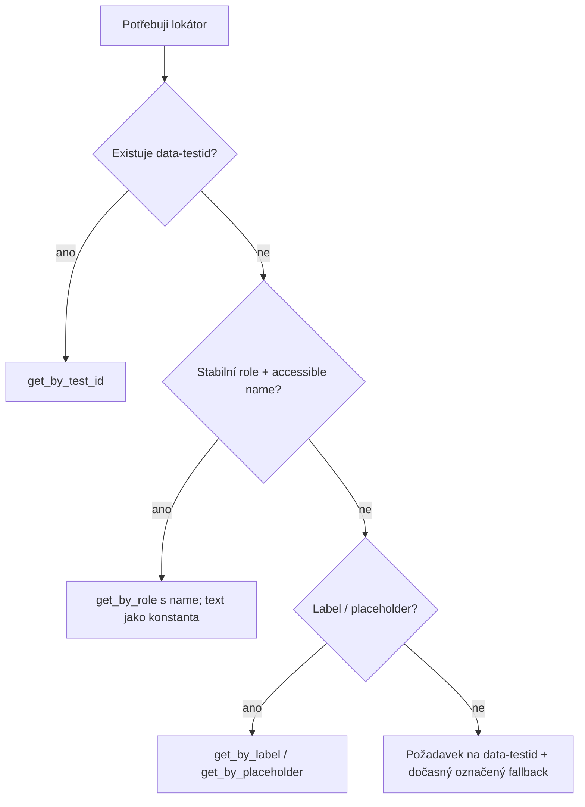

# Plán: Skill `locator-strategy` (tvorba, revize a údržba lokátorů)

## Goal Description
Vytvořit projektový skill v `.agents/skills/locator-strategy/`, který povede agenta při **psaní, revizi a opravě lokátorů** v Page Objectech (Playwright + pytest, Python). Strukturou naváže na existující skill `assertion-quality-review` (SKILL.md + `references/`, česky, režimy aktivace, Před vs Po, checklist).

Z průzkumu repozitáře plyne, že skill má kodifikovat to, co už projekt dělá, a opravit nekonzistence:
- Převažuje `get_by_test_id(...)` (login, courses, enroll, navbar). To odpovídá [PLAN_LOCATORS_REFACTOR.md](file:///c:/Users/marti/Documents/VyvojAplikaci/QA_AI_kurz/Lekce1/plans/PLAN_LOCATORS_REFACTOR.md) (Zero-Inline-Locators, jednotné `data-testid`).
- Místy se míchají strategie, např. `page.locator("button[data-testid='registration_link']")`, `page.locator("[data-testid^='iteration_']")`, `page.locator("input[type='file']")`.
- Role/text lokátory jsou závislé na češtině: `get_by_role("button", name="Nezávazná registrace")`, `get_by_role("link", name="Moje kurzy")`.
- `get_by_text("We can't find a user with that email address.")` závisí na anglické hlášce z backendu.
- `.first` v [courses_page.py](file:///c:/Users/marti/Documents/VyvojAplikaci/QA_AI_kurz/Lekce1/pages/courses_page.py) (`detail_buttons.first.click()`) je křehké, pokud na pořadí záleží.
- Chybí pravidlo, jak lokátory navrhovat pro dynamické seznamy (karty iterací, řádky studentů).

## Co by měl dobrý skill na lokátory obsahovat

| # | Obsah | Proč |
|---|---|---|
| 1 | **Hierarchie priorit** lokátorů (rozhodovací strom) | Agent nemusí hádat. Vždy vybere nejstabilnější možnost. |
| 2 | **Konvence `data-testid`** (`snake_case`, prefixy, názvy pro seznamy, pole a chyby) | Jednotné názvy, předvídatelné i pro nové stránky. |
| 3 | **Zakázané / rizikové vzory** (absolutní XPath, `nth-child`, CSS třídy stylování, text závislý na jazyce, `.first` bez důvodu, `time.sleep`) | Hlavní zdroj flaky testů. |
| 4 | **Pravidla POM**: Zero-Inline-Locators, kde lokátory žijí, `Locator` jako atributy a parametrizované lokátory jako metody (např. `iteration_card(id)`) | Navazuje na stávající architekturu. |
| 5 | **Dynamický obsah**: filtrování (`filter(has_text=...)`, `has=`), scoping do kontejneru, řetězení lokátorů | Karty kurzů, iterace, seznam studentů. |
| 6 | **Strict mode a jednoznačnost**: kdy použít `to_have_count`, kdy je `first`/`nth` obhajitelné | Playwright při více shodách selže. Skill ukáže správnou reakci. |
| 7 | **Lokalizace (CZ/EN)**: role+name jen pokud je text kontrakt, jinak testid. Texty držet v konstantách. | V projektu se mísí obě řešení. |
| 8 | **Postup při chybějícím `data-testid`**: neobcházet CSS hackem. Vytvořit požadavek na vývojáře (šablona) a do doby doručení použít dočasný, označený fallback. | Projekt testuje cizí aplikaci. |
| 9 | **Postup ladění**: `codegen`, Inspector, `page.pause()`, `locator.highlight()`, tracing, ověření počtu shod | Reprodukovatelný workflow. |
| 10 | **Režimy aktivace**: nový lokátor / oprava rozbitého lokátoru / audit stávajících Page Objectů | Stejný vzor jako `assertion-quality-review`. |
| 11 | **Katalog Před vs Po** (reálné příklady z projektu) | Few-shot příklady fungují lépe než pravidla. |
| 12 | **Checklist + audit skript** pro automatickou kontrolu zakázaných vzorů | Deterministická kontrola místo úsudku. |
| 13 | **Vazba na `assertion-quality-review`** | Dobrý lokátor + dobrý assert, bez duplikace obsahu. |

## User Review Required
> [!IMPORTANT]
> Skill bude psaný **česky** (jako stávající), kód a identifikátory anglicky. Dejte vědět, pokud chcete jinak.

> [!NOTE]
> Skill **nebude měnit** existující Page Objecty. Nálezy z auditu půjdou do samostatného reportu a případná oprava do samostatného úkolu, až ji schválíte.

## Rozhodnutí (potvrzeno uživatelem)
> [!IMPORTANT]
> 1. **Audit skript:** ANO, `scripts/audit_locators.py` bude součástí skillu (jen čte a vypisuje nálezy, nic nemění).
> 2. **Priorita lokátorů:** `data-testid` první. Pokud chybí, povoleny `get_by_role`, label, placeholder, případně text, vždy s krátkým komentářem proč.
> 3. **Zero-Inline-Locators v `tests/`:** TVRDÝ ZÁKAZ (dnes 0 porušení). Audit skript v `tests/` hlásí jakýkoli lokátor jako chybu.
> 4. **Navázání na projekt:** odkaz jen v [tests/AGENTS.md](file:///c:/Users/marti/Documents/VyvojAplikaci/QA_AI_kurz/Lekce1/tests/AGENTS.md). `pages/AGENTS.md` se nevytváří.

## Proposed Changes

### Skill `locator-strategy`

#### [NEW] `.agents/skills/locator-strategy/SKILL.md`
Frontmatter s `name` a `description` (spouštěče: nový lokátor, oprava rozbitého, audit). Sekce:
1. Klíčový princip: lokátor má cílit na **záměr uživatele/kontrakt**, ne na implementaci DOM.
2. **Rozhodovací strom** (mermaid):



3. Tři režimy aktivace (tvorba / oprava / audit).
4. Pravidla POM a Zero-Inline-Locators.
5. Dynamický obsah, scoping a strict mode.
6. Lokalizace.
7. Zakázané vzory s náhradami.
8. Postup ladění lokátoru.
9. Výstupní formát odpovědi agenta: *co bylo křehké → proč → nový lokátor → jak ověřeno*.
10. Odkazy na `references/` a skript.

#### Návrh `description` (frontmatter)
```yaml
---
name: locator-strategy
description: >-
  Aktivuj a použij tento skill v následujících situacích:
  1. Tvorba nového lokátoru nebo celého Page Objectu (výběr nejstabilnější strategie, konvence data-testid).
  2. Oprava nebo refaktoring rozbitého či křehkého lokátoru (test padá na strict mode violation, timeoutu nebo po změně UI).
  3. Požadavek na audit, revizi nebo kontrolu lokátorů v pages/ a tests/ (zakázané vzory, lokátory v testech).
  4. Prvek, který potřebuji v testu použít, nemá data-testid (postup pro chybějící lokátor).
---
```

#### Návrh těla `SKILL.md` (konkrétní obsah sekcí)
| Sekce | Konkrétní obsah |
|---|---|
| **Úvod a klíčový princip** | Lokátor cílí na kontrakt prvku (testid, role, label), ne na strukturu DOM. Priorita: `data-testid`, potom role+name, label, placeholder, text. |
| **1. Režimy aktivace** | Tvorba: projdi rozhodovací strom, ověř jednoznačnost (`to_have_count(1)`). Oprava: nejdřív zjisti příčinu (zmizel prvek? více shod? změnil se text?), teprve potom měň lokátor, nikdy ho nezvágňuj. Audit: spusť `audit_locators.py`, nálezy roztřiď podle závažnosti, předlož Před vs Po. |
| **2. Rozhodovací strom** | Mermaid diagram viz výše, plus tabulka "kdy co použít". |
| **3. Pravidla POM** | V `tests/` žádný lokátor (tvrdý zákaz). Lokátory jsou atributy Page Objectu typu `Locator`. Parametrizované lokátory jsou metody (`course_card(name)`). Sdílené prvky patří do komponenty (`Navbar`). |
| **4. Dynamický obsah** | `filter(has_text=...)`, `has=`, scoping do kontejneru, žádné `.first`/`.nth()` bez komentáře s důvodem. |
| **5. Lokalizace** | Text v lokátoru jen jako pojmenovaná konstanta. Preferovat `data-testid`, který na jazyce nezávisí. |
| **6. Zakázané vzory** | Tabulka "vzor, proč je zlý, čím nahradit": XPath, `nth-child`, CSS třídy, `time.sleep`, `.first` bez důvodu, text závislý na jazyce. |
| **7. Chybějící lokátor** | Viz samostatná sekce níže. |
| **8. Ladění** | `playwright codegen`, Inspector, `page.pause()`, `locator.highlight()`, `locator.count()`. |
| **9. Výstupní formát odpovědi** | Co bylo křehké, proč, nový lokátor, jak ověřeno. Při chybějícím lokátoru navíc požadavek na vývojáře. |
| **10. Odkazy** | `references/*`, `scripts/audit_locators.py`, `assertion-quality-review`. |

#### Postup, když prvek požadovaný lokátor (`data-testid`) nemá
Aplikace je cizí a nemáme na ni zásah, proto se agent řídí těmito kroky:
1. **Ověř, že `data-testid` opravdu chybí.** Prohlédni DOM (codegen nebo snapshot stránky) a zkontroluj, jestli prvek nemá testid pod jiným, podobným názvem.
2. **Projdi žebříček náhrad shora dolů** a vezmi první stabilní, jednoznačnou možnost:
   1. `get_by_role(role, name=...)`
   2. `get_by_label(...)` pro formulářová pole
   3. `get_by_placeholder(...)`
   4. `get_by_text(...)` jen pro statický text a vždy s textem v konstantě
   5. Pokud je prvek uvnitř kontejneru s testid, zúž hledání: `kontejner.get_by_role(...)`
3. **Zakázáno i při chybějícím testid:** XPath, `nth-child`, CSS třídy ze stylování, absolutní cesty v DOM, `.first` jen proto, aby prošla strict mode.
4. **Ověř jednoznačnost** (`expect(locator).to_have_count(1)`) a že lokátor nezávisí na pořadí prvků.
5. **Označ fallback v kódu** greppovatelným komentářem:
   ```python
   # TODO(testid): chybí data-testid pro odeslání formuláře; fallback role+name
   self.submit_button = page.get_by_role("button", name=SUBMIT_LABEL)
   ```
   Audit skript tyto značky vypíše jako seznam dluhu.
6. **Vytvoř požadavek na vývojáře** a uveď ho v odpovědi uživateli:
   ```
   Stránka: /courses/create | Prvek: tlačítko "Vytvořit kurz"
   Navržený testid: create_course_submit_button
   Důvod: lokátor dnes závisí na českém textu
   ```
7. **Když žádná z náhrad není stabilní** (např. prvek bez role, textu a labelu), agent **zastaví práci na tomto lokátoru, nic nevymýšlí** a zeptá se uživatele.
8. **Až vývojáři testid doplní,** fallback se vymění za `get_by_test_id` a značka TODO se smaže.

#### [NEW] `.agents/skills/locator-strategy/references/checklist.md`
Rychlý checklist a tahák Playwright API: `get_by_test_id`, `get_by_role`, `get_by_label`, `filter`, řetězení, `and_`/`or_`.

#### [NEW] `.agents/skills/locator-strategy/references/testid-conventions.md`
Pojmenování `data-testid`: `snake_case`, `<entita>_<prvek>` (např. `course_name_input`), chyby `<pole>_error`, seznamy `<entita>_card`. Tabulka stávajících testid v projektu. Šablona požadavku na vývojáře.

#### [NEW] `.agents/skills/locator-strategy/references/examples.md`
Před vs Po na reálných případech z repozitáře:
- `button[data-testid='registration_link']` → `get_by_test_id` + `filter` (nebo požadavek na jedinečný testid)
- `[data-testid^='iteration_']` → explicitní testid karty nebo `filter`
- `detail_buttons.first.click()` → lokátor vázaný na konkrétní kurz (`course_card(name)`)
- `get_by_text("We can't find a user...")` → testid nebo konstanta
- `input[type='file']` → `get_by_test_id("course_image_input")` / `get_by_label`

#### [NEW] `.agents/skills/locator-strategy/scripts/audit_locators.py`
Prochází `pages/` a `tests/`:
- v `tests/` hlásí jakékoli `page.locator(`, `get_by_*` (porušení Zero-Inline-Locators),
- v `pages/` hlásí XPath, `nth-child`, `.first`/`.nth(` bez komentáře, `time.sleep`, CSS třídy,
- výstup `soubor:řádek: pravidlo`, exit code ≠ 0 při nálezu.

### Navázání na projekt

#### [MODIFY] `tests/AGENTS.md`
Přidat krátkou sekci s odkazem na skill `locator-strategy` (stávající text beze změny).

## Verification Plan

### Automated Tests
```powershell
# Kontrola frontmatteru
Get-Content .agents\skills\locator-strategy\SKILL.md -TotalCount 12
# Audit skript nad projektem
.venv\Scripts\python .agents\skills\locator-strategy\scripts\audit_locators.py pages tests
# Regrese: kód se nemění, suite se musí dál sbírat
.venv\Scripts\pytest --collect-only -q
```

### Manual Verification
- Zadat agentovi "přidej lokátory pro novou stránku X" a zkontrolovat, že postupuje podle rozhodovacího stromu.
- Zadat "zrevidovat `courses_page.py`" a ověřit, že najde `.first`, CSS selektory a textové lokátory.
- Zkontrolovat, že skill neduplikuje obsah `assertion-quality-review`.
